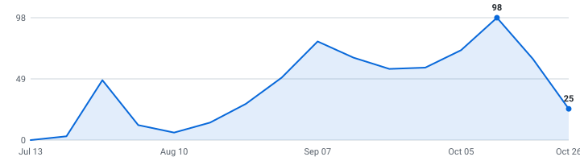

  <h1>🇮🇳 India Tech Internships</h1>
  
<strong>A self-updating engine tracking tech internships in India so you don't have to.</strong>

  

    
    
    
  

  

    
    
    
  

  
<em>Last updated: Oct 18, 2026 at 07:43 UTC</em>

---

## Summer 2027 (India) <kbd>97 open</kbd>

| 🏢 Company | 💼 Role | 🏷️ Category | 💰 Pay & Specs | 📍 Location | 📅 Posted | 🔗 Apply |
|---|---|---|---|---|---|:---:|
| **Nestack Technologies Pvt Ltd** | Software Developer Intern ~ 🆕 | `Software` | **₹12,000 / month** | Hyderabad, Telangana, India, On-site | Oct 17, 2026 | [Apply ↗](https://neilp.nestack.ai/career/internship) |
| | `python` `javascript` `react` `node.js` ||||||
| **FynTune Solution Private Limited** | PHP Developer Intern ~ 🆕 | `Software` | — | Navi Mumbai, Maharashtra, India, On-s… | Oct 17, 2026 | [Apply ↗](https://internshala.com/internship/detail/junior-php-developer-internship-in-multiple-locations-at-fyntune-solution-private-limited1792128021/?utm_campaign=linkedin_d2002&utm_source=Linkedin_Partnership) |
| | `php` `laravel` `html` `css` ||||||
| **BiteSpeed** | AI Video Creator Internship ~ 🆕 | `Data &amp; ML/AI` | — | Bengaluru, Karnataka, India, On-site | Oct 17, 2026 | [Apply ↗](https://internshala.com/internship/detail/ai-video-creator-internship-in-bangalore-at-bitespeed1792143876/?utm_campaign=linkedin_d2002&utm_source=Linkedin_Partnership) |
| **HARMAN India** | Software Engineering Intern ~ 🆕 | `Software` | B.E/B.Tech | Pimpri Chinchwad, Maharashtra, India | Oct 16, 2026 | [Apply ↗](https://jobsearch.harman.com/careers/searchjobs/R-56676-2026?source=LinkedIn) |
| | `java` `kotlin` `android` `google test framework` ||||||
| **Volody** | Cloud Monitoring intern ~ 🆕 | `Software` | computer science/cybersecurity | Mumbai, Maharashtra, India, On-site | Oct 16, 2026 | [Apply ↗](https://www.linkedin.com/jobs/view/4477354757/) |
| | `aws` `azure` `splunk` `microsoft sentinel` ||||||
| **BiteSpeed** | AI Video Creator Intern ~ 🆕 | `Data &amp; ML/AI` | **₹20,000 / month** | Bengaluru, Karnataka, India | Oct 16, 2026 | [Apply ↗](https://www.linkedin.com/jobs/view/4480332583/) |
| | `ai fundamentals` `ugc` `direct client interaction` ||||||
| **Wayfair** | Software Engineer Intern ~ 🆕 | `Software` | B.E/B.Tech | Bengaluru, Karnataka, India, On-site | Oct 16, 2026 | [Apply ↗](https://wayfair.avature.net/en_US/careers?folderId=20829&src=LinkedIn_Job_Slots) |
| | `python` `java` `c++` `sql` ||||||
| **Valency Networks Private Limited** | C++ Developer Intern ~ 🆕 | `Software` | — | Pune City, Maharashtra, India, On-site | Oct 15, 2026 | [Apply ↗](https://www.linkedin.com/jobs/view/4477060964/) |
| | `c++` `object oriented programming` `data structures` `debugging` ||||||
| **Volody** | Software tester intern ~ 🆕 | `Software` | Computer Science/Information Technology | Goregaon, Maharashtra, India, On-site | Oct 15, 2026 | [Apply ↗](https://www.linkedin.com/jobs/view/4477074268/) |
| | `test execution` `defect tracking` `quality assurance` `web applications` ||||||
| **Honeywell Technologies** | AI Intern ~ 🆕 | `Data &amp; ML/AI` | — | Madurai, Tamil Nadu, India, On-site | Oct 15, 2026 | [Apply ↗](https://ibqbjb.fa.ocs.oraclecloud.com/hcmUI/CandidateExperience/en/job/159740/?utm_medium=jobboard&utm_source=linkedin) |
| **Eli Lilly and Company** | Data Analyst Intern ~ 🆕 | `Data &amp; ML/AI` | Statistics/Mathematics/Engineering/Computer Sciences | Bengaluru East, Karnataka, India, On-… | Oct 15, 2026 | [Apply ↗](https://careers.lilly.com/us/en/job/LILLUSR113282EXTERNALENUS/Intern-CI-A-Data-Analyst?utm_source=linkedin&utm_medium=phenom-feeds) |
| | `sql` `powerbi` `databricks` `generative ai` ||||||
| **Honeywell Technologies** | Software Engineering Intern ~ 🆕 | `Software` | — | Hyderabad, Telangana, India, On-site | Oct 15, 2026 | [Apply ↗](https://ibqbjb.fa.ocs.oraclecloud.com/hcmUI/CandidateExperience/en/job/159842/?utm_medium=jobboard&utm_source=linkedin) |
| | `java` `python` `c++` ||||||
| **Honeywell Technologies** | Intern Bachelors AI Eng ~ 🆕 | `Data &amp; ML/AI` | — | Hyderabad, Telangana, India, On-site | Oct 15, 2026 | [Apply ↗](https://ibqbjb.fa.ocs.oraclecloud.com/hcmUI/CandidateExperience/en/job/159836/?utm_medium=jobboard&utm_source=linkedin) |
| | `python` `sql` `tableau` ||||||
| **Fluence** | Software Quality Intern ~ 🆕 | `Software` | — | India - Bangalore | Oct 15, 2026 | [Apply ↗](https://fluenceenergy.wd12.myworkdayjobs.com/en-US/fluenceenergy-jobs/job/India---Bangalore/Intern-Engineer---Software-Quality---Automation_JR101544) |
| | `python` `javascript` `git` `jira` ||||||
| **Marvell** | Generative AI Forward Deployed Engineer Intern- Master&#x27;s Degree ~ | `Data &amp; ML/AI` | B.Tech/BS | Bangalore | Oct 15, 2026 | [Apply ↗](https://marvell.wd1.myworkdayjobs.com/MarvellCareers2/job/Bangalore/Generative-AI-Forward-Deployed-Engineer-Intern--Master-s-Degree_2604231) |
| | `Python` `Java` `PyTorch` `TensorFlow` ||||||
| **Marvell** | Intern, Software Engineer ~ | `Software` | B.Tech/BS | Hyderabad | Oct 15, 2026 | [Apply ↗](https://marvell.wd1.myworkdayjobs.com/MarvellCareers2/job/Hyderabad/Intern--Software-Engineer_2604241) |
| | `Python` `Kubernetes` `Linux` ||||||
| **Bank of America** | Apprentice Software Developer ~ 🆕 | `Software` | B.Tech/B.E | Gurugram, Haryana, India, On-site | Oct 14, 2026 | [Apply ↗](https://careers.bankofamerica.com/en-us/job-detail/26036898/apprentice-multiple-locations) |
| | `python` `sql` `spark` `tableau` ||||||
| **Bank of America** | Apprentice Software Developer ~ 🆕 | `Software` | B.Tech/B.E | Chennai, Tamil Nadu, India, On-site | Oct 14, 2026 | [Apply ↗](https://careers.bankofamerica.com/en-us/job-detail/26036901/apprentice-multiple-locations) |
| | `python` `sql` `spark` `tableau` ||||||
| **Volody** | Cloud Monitoring intern ~ 🆕 | `Software` | computer science/cybersecurity | Mumbai, Maharashtra, India, On-site | Oct 14, 2026 | [Apply ↗](https://www.linkedin.com/jobs/view/4476636309/) |
| | `aws` `azure` `splunk` `microsoft sentinel` ||||||
| **EDMO** | Software Engineer Intern ~ 🆕 | `Software` | — | Pune Division, Maharashtra, India, On… | Oct 14, 2026 | [Apply ↗](https://edmo.keka.com/careers/jobdetails/144428?source=linkedin) |
| | `python` `node.js` `javascript` `git` ||||||
| **Vahan.ai** | Software Engineer Intern ~ 🆕 | `Software` | computer science | Bengaluru, Karnataka, India, On-site | Oct 14, 2026 | [Apply ↗](https://forms.gle/E2vKCnK6eojB6To9A) |
| | `react` `node.js` `postgresql` `git` ||||||
| **Impact Analytics** | DevOps Intern ~ 🆕 | `Software` | — | Bengaluru, KA, India | Oct 14, 2026 | [Apply ↗](https://impactanalytics.keka.com/careers/jobdetails/92315) |
| | `gcp` `aws` `ci/cd` `observability` ||||||
| **NewSpace Research** | Software Development Intern ~ 🆕 | `Software` | — | Bangalore, KA, India | Oct 14, 2026 | [Apply ↗](https://newspace.keka.com/careers/jobdetails/144497) |
| **Emerson** | Software Engineer Trainee ~ 🆕 | `Software` | B.Tech/M.Tech | PUNE, MAHARASHTRA, India, ORA_ON_SITE | Oct 14, 2026 | [Apply ↗](https://hdjq.fa.us2.oraclecloud.com/hcmUI/CandidateExperience/en/sites/CX/job/26009291) |
| | `c#` `c++` `java` `python` ||||||
| **Carousell Group** | Android Engineer Intern - 6 months ~ | `Software` | — | Bengaluru, KA, India | Oct 14, 2026 | [Apply ↗](https://jobs.smartrecruiters.com/carousellgroup/744000155411579) |
| | `Kotlin` ||||||
| **NVIDIA** | CPU Compiler Intern ~ 🆕 | `Software` | — | Pune City, Maharashtra, India, On-site | Oct 13, 2026 | [Apply ↗](https://nvidia.wd5.myworkdayjobs.com/NVIDIAExternalCareerSite/job/India-Pune/CPU-Compiler-Intern---2027_JR2027260-1?source=jobboardlinkedin) |
| | `c++` `gcc` `llvm` ||||||
| **Volody** | Cloud Monitoring intern ~ 🆕 | `Software` | — | Mumbai, Maharashtra, India, On-site | Oct 13, 2026 | [Apply ↗](https://www.linkedin.com/jobs/view/4476085759/) |
| | `cloud platforms` `monitoring tools` `dashboards` ||||||
| **Seagate Technology** | Software Development Intern ~ 🆕 | `Software` | — | Pune Division, Maharashtra, India, On… | Oct 13, 2026 | [Apply ↗](https://seagatecareers.com/job/Pune-Intern-Software-Development/1439401300/?feedId=326100&utm_source=LinkedInJobPostings&utm_campaign=Seagate_LinkedIn&source=APPLICANT_SOURCE-3-387) |
| | `c/c++` `python` `ci/cd` `docker` ||||||
| **MKS Inc.** | Computer Science Engineer Intern ~ 🆕 | `Software` | — | Gurgaon, Haryana, India, On-site | Oct 13, 2026 | [Apply ↗](https://mksinst.wd1.myworkdayjobs.com/MKSCareersEMEA/job/India-Gurgaon/XMLNAME-2027-Spring-Computer-Science-Engineer-Undergraduate-Intern_R20784) |
| | `service now` `sql` `javascript` `git` ||||||
| **NVIDIA** | CPU Compiler Intern ~ 🆕 | `Software` | — | Bengaluru, Karnataka, India, On-site | Oct 13, 2026 | [Apply ↗](https://nvidia.wd5.myworkdayjobs.com/NVIDIAExternalCareerSite/job/India-Pune/CPU-Compiler-Intern---2027_JR2027260-1?source=jobboardlinkedin) |
| | `c++` `compiler optimization` `gcc` `llvm` ||||||
| **Fujitsu** | AI Apprentice ~ 🆕 | `Data &amp; ML/AI` | — | Pune/Pimpri-Chinchwad Area, On-site | Oct 13, 2026 | [Apply ↗](https://www.jobs.global.fujitsu.com/job/GDU-AIP-AI-Apprentice/12893-en_US) |
| | `python` `react` `typescript` `aws` ||||||
| **CloudSEK** | SDE Intern - Backend ~ | `Software` | B.Tech/BS | Bengaluru, Karnataka, India | Oct 13, 2026 | [Apply ↗](https://job-boards.greenhouse.io/cloudsek/jobs/6222340004) |
| | `SQL` `Node.js` `AWS` `GCP` ||||||
| **Scopely** | Intern - QA Engineer - Royal Lounge Casino ~ | `Software` | B.Tech/BS | IN - Bangalore, India | Oct 13, 2026 | [Apply ↗](https://job-boards.greenhouse.io/scopely/jobs/5448999008?gh_jid=5448999008) |
| **Setu** | Infosec Intern ~ 🆕 | `Other` | — | Bengaluru, Karnataka, India, On-site | Oct 12, 2026 | [Apply ↗](https://forms.gle/nYnHp6Rn8SQg1W4K9) |
| | `iso 27001` `soc2` `pci dss` `rbi guidelines` ||||||
| **Vecmocon** | Software Quality Assurance Intern ~ 🆕 | `Software` | — | Noida, UP, India | Oct 12, 2026 | [Apply ↗](https://vecmocon.keka.com/careers/jobdetails/166181) |
| | `html` `css` `test cases` ||||||
| **Emerson** | Metrology Software Engineering Intern ~ 🆕 | `Software` | — | DEBRECEN, HAJDÚ BIHAR, Hungary, ORA_H… | Oct 12, 2026 | [Apply ↗](https://hdjq.fa.us2.oraclecloud.com/hcmUI/CandidateExperience/en/sites/CX/job/26011734) |
| | `LabVIEW` ||||||
| **Heads Up For Tails** | Software Engineering Intern ~ 🆕 | `Software` | — | Gurugram, Haryana, India | Oct 10, 2026 | [Apply ↗](https://www.linkedin.com/jobs/view/4477207173/) |
| | `node.js` `mongodb` `react` `mern stack` ||||||
| **ByteDance** | Data Analyst Intern ~ 🆕 | `Data &amp; ML/AI` | — | Gurgaon, Haryana, India, On-site | Oct 10, 2026 | [Apply ↗](https://joinbytedance.com/search/7656823895123446069) |
| | `excel` `data analysis` `reporting` ||||||
| **Micron school erp** | QA &amp; Tech Support Intern ~ 🆕 | `Other` | BCA/B.Tech/BSc IT | Sahibzada Ajit Singh Nagar, Punjab, I… | Oct 09, 2026 | [Apply ↗](https://www.micronerp.com/careers/cmth9l2cf002mm6010l370tt2) |
| | `customer support` ||||||
| **Netcore** | AI Automation Intern ~ 🆕 | `Data &amp; ML/AI` | Computer Science/AI/Data Science | Mumbai, Maharashtra, India, On-site | Oct 09, 2026 | [Apply ↗](https://tally.so/r/jadZQ1) |
| | `llms` `ai agents` `automation platforms` `prompt engineering` ||||||
| **GoKwik** | AI Intern ~ 🆕 | `Data &amp; ML/AI` | — | Bangalore, KA, India | Oct 09, 2026 | [Apply ↗](https://gokwik.keka.com/careers/jobdetails/163424) |
| | `ai agents` ||||||
| **Philips** | Data Science Intern ~ 🆕 | `Data &amp; ML/AI` | — | Bengaluru, Karnataka, India, On-site | Oct 08, 2026 | [Apply ↗](https://philips.wd3.myworkdayjobs.com/jobs-and-careers/job/Bangalore/Intern---Data-Science-and-AI-Engineering_590503/?source=LinkedIn) |
| **Discover** | AI Engineer Intern ~ 🆕 | `Data &amp; ML/AI` | B.E./B.Tech/M.Tech/MCA | Bangalore, KA, India | Oct 08, 2026 | [Apply ↗](https://discoverdollar.keka.com/careers/jobdetails/164757) |
| | `langgraph` `deepagents` `fastapi` `mlflow` ||||||
| **Red Hat** | Software Engineering Intern ~ 🆕 | `Software` | — | Bengaluru, Karnataka, India, On-site | Oct 07, 2026 | [Apply ↗](https://redhat.wd5.myworkdayjobs.com/jobs/job/Pune---Tower-6/Software-Engineering-Intern_R-058560?%26%3Fmode=job&%26iis=Job%2BBoard&%26iisn=LinkedIn%2BPosting&source=LinkedIn) |
| | `python` `golang` `github` `java` ||||||
| **Enterpret** | Software Engineering Intern ~ 🆕 | `Software` | — | Bengaluru, Karnataka, India, Onsite | Oct 07, 2026 | [Apply ↗](https://grnh.se/6l3ky9cm3us) |
| | `aws` `serverless` `distributed systems` `real-time inference` ||||||
| **PW (PhysicsWallah)** | AI Engineer Intern ~ 🆕 | `Data &amp; ML/AI` | — | Noida, Uttar Pradesh, India, On-site | Oct 07, 2026 | [Apply ↗](https://forms.gle/zDrnE6iAVRfCBtpk8) |
| | `python` `react` `sql` `n8n` ||||||
| **Teachmint** | Full Stack Developer Intern ~ 🆕 | `Software` | — | Bangalore, KA, India | Oct 07, 2026 | [Apply ↗](https://teachmint.keka.com/careers/jobdetails/143815) |
| | `react` `node.js` `mongodb` `rest apis` ||||||
| **TÜV SÜD** | Quality Assurance Intern ~ 🆕 | `Other` | MCA/IT | Vadodara, Gujarat, India, On-site | Oct 06, 2026 | [Apply ↗](https://www.linkedin.com/jobs/view/4474032231/) |
| | `automation testing` `oop` `data structures` ||||||
| **iRage** | Software Developer Intern ~ 🆕 | `Software` | — | Mumbai, Maharashtra, India, On-site | Oct 05, 2026 | [Apply ↗](https://forms.gle/mdMbL91HT8MfFhjb7) |
| | `c++` `go` ||||||
| **Siemens Gamesa** | Intern - Turbine Software System Validation ~ 🆕 | `Software` | — | Bengaluru, Karnataka, India, On-site | Oct 05, 2026 | [Apply ↗](https://jobs.siemens-energy.com/Jobs/FolderDetail?folderId=303402&source=LinkedIn) |
| | `python` `selenium` `behave` `git` ||||||
| **Siemens Gamesa** | Automation / AI Intern ~ 🆕 | `Data &amp; ML/AI` | — | Bengaluru, Karnataka, India, On-site | Oct 05, 2026 | [Apply ↗](https://jobs.siemens-energy.com/Jobs/FolderDetail?folderId=302765&source=LinkedIn) |
| | `python` `ai` `data analytics` `excel automation` ||||||
| **Siemens Gamesa** | Software Development and Testing Intern ~ 🆕 | `Software` | B.Tech/M.Tech | Bengaluru, Karnataka, India, On-site | Oct 05, 2026 | [Apply ↗](https://jobs.siemens-energy.com/Jobs/FolderDetail?folderId=303119&source=LinkedIn) |
| | `python` `matlab` `git` `jira` ||||||
| **EMotorad** | Frontend Intern ~ 🆕 | `Software` | — | Gurugram, Haryana, India | Oct 05, 2026 | [Apply ↗](https://www.linkedin.com/jobs/view/4475580374/) |
| | `react` `next.js` `flutter` `typescript` ||||||
| **Valeo** | Software Intern ~ 🆕 | `Software` | — | Chennai | Oct 05, 2026 | [Apply ↗](https://valeo.wd3.myworkdayjobs.com/en-US/valeo_jobs/job/Chennai/Intern---Software_REQ2026070899) |
| | `matlab` `simulink` `embedded c` `autosar` ||||||
| **Atidan Technologies** | Software Trainee ~ 🆕 | `Software` | — | Mumbai, Maharashtra, India | Oct 04, 2026 | [Apply ↗](https://www.linkedin.com/jobs/view/4463794839/) |
| | `testing` `analysis` `debugging` ||||||
| **Kaleris** | Software Engineer Intern ~ 🆕 | `Software` | B.Tech | Chennai, Tamil Nadu, India, On-site | Oct 03, 2026 | [Apply ↗](https://kaleris.wd501.myworkdayjobs.com/kaleris_careers/job/Chennai/Associate-Software-Engineer---Intern_R-100644?source=LinkedIn) |
| | `java` `sql` `rest apis` `spring` ||||||
| **Kaleris** | Quality Assurance Engineer Intern ~ 🆕 | `Software` | — | Chennai, Tamil Nadu, India, On-site | Oct 03, 2026 | [Apply ↗](https://kaleris.wd501.myworkdayjobs.com/kaleris_careers/job/Chennai/Associate-Quality-Assurance-Engineer---Intern_R-100638?source=LinkedIn) |
| | `uft` `testng` `selenium` `maven` ||||||
| **Honasa Consumer Ltd.** | AI Intern ~ 🆕 | `Data &amp; ML/AI` | — | Gurugram, Haryana, India | Oct 01, 2026 | [Apply ↗](https://www.linkedin.com/jobs/view/4472919251/) |
| | `python` `sql` `apis` `data pipelines` ||||||
| **Marvell Technology** | Research Intern Physical AI GPU ~ 🆕 | `Data &amp; ML/AI` | PhD/MTech by Research | Hyderabad | Oct 01, 2026 | [Apply ↗](https://marvell.wd1.myworkdayjobs.com/en-US/MarvellCareers/job/Hyderabad/Research-Intern--Physical-AI-and-GPU--PhD-_2604253) |
| | `cuda` `pytorch` `tensorflow` `c/c++` ||||||
| **GreedyGame** | Fullstack Developer Intern ~ 🆕 | `Software` | — | Bengaluru, Karnataka, India, On-site | Sep 30, 2026 | [Apply ↗](https://www.linkedin.com/jobs/view/4472153913/) |
| | `go` `react` `mysql` `postgresql` ||||||
| **Heads Up For Tails** | QA Intern ~ 🆕 | `Other` | — | Gurugram, Haryana, India | Sep 30, 2026 | [Apply ↗](https://www.linkedin.com/jobs/view/4472339005/) |
| | `test scenarios` `testing` `test cases` ||||||
| **GreedyGame** | Fullstack Developer Internship ~ 🆕 | `Software` | — | Bengaluru, Karnataka, India | Sep 30, 2026 | [Apply ↗](https://www.linkedin.com/jobs/view/4473724223/) |
| | `go` `react.js` `postgresql` `mongodb` ||||||
| **Marvell** | AI Intern ~ | `Data &amp; ML/AI` | B.Tech/BS | Bangalore | Sep 30, 2026 | [Apply ↗](https://marvell.wd1.myworkdayjobs.com/MarvellCareers2/job/Bangalore/AI-Intern_2604445) |
| **Rubrik** | Software Engineer Intern ~ 🆕 | `Software` | — | Bengaluru, Karnataka, India, On-site | Sep 29, 2026 | [Apply ↗](https://www.rubrik.com/company/careers/departments/job.8166523?gh_jid=8166523&gh_src=2e352a8a1us) |
| | `java` `c/c++` `scala` `python` ||||||
| **NatWest Group** | AI ML Trainee ~ 🆕 | `Data &amp; ML/AI` | B.Tech/M.Tech | Bengaluru, Karnataka, India, On-site | Sep 29, 2026 | [Apply ↗](https://jobs.natwestgroup.com/jobs/18289724-ai-ml-trainee-6-month-fixed-term-contract-2026-graduates?tm_job=R-00285898-OTHLOC-IND-5FBAN016&tm_event=view&tm_company=861&bid=56) |
| | `java` `ai/ml` `devops` `agile` ||||||
| **Thoughtworks** | Software Procurement Intern ~ | `Software` | — | Gurgaon, India; Pune, India | Sep 28, 2026 | [Apply ↗](https://www.thoughtworks.com/careers/jobs/8236673?gh_jid=8236673) |
| | `Vue` `AWS` ||||||
| **Vecmocon** | Frappe Developer Intern ~ 🆕 | `Software` | — | Noida, UP, India | Sep 27, 2026 | [Apply ↗](https://vecmocon.keka.com/careers/jobdetails/163165) |
| | `python` `javascript` `mysql` `rest apis` ||||||
| **BNP Paribas** | Data Science Intern ~ 🆕 | `Data &amp; ML/AI` | — | Bengaluru, Karnataka, India, On-site | Sep 25, 2026 | [Apply ↗](https://group.bnpparibas/en/careers/job-offer/data-science-intern-1?SRC=LINKEDIN) |
| | `python` `tensorflow` `pytorch` `sklearn` ||||||
| **Sprinklr** | ML Intern ~ 🆕 | `Data &amp; ML/AI` | Computer Science | India - Haryana - Gurgaon | Sep 25, 2026 | [Apply ↗](https://sprinklr.wd1.myworkdayjobs.com/en-US/careers/job/India---Haryana---Gurgaon/ML-Intern_113518-JOB) |
| | `data structures` `algorithms` `ai/ml` `full-stack projects` ||||||
| **Honeywell Aerospace** | AI Intern ~ 🆕 | `Data &amp; ML/AI` | M.Tech/MS | Bengaluru, Karnataka, India, On-site | Sep 24, 2026 | [Apply ↗](https://icfcjb.fa.ocs.oraclecloud.com/hcmUI/CandidateExperience/en/job/124443/?utm_medium=jobboard&utm_source=linkedin) |
| | `python` `tensorflow` `pytorch` ||||||
| **Microsoft** | Data Science Intern ~ 🆕 | `Data &amp; ML/AI` | — | Multiple Locations, Multiple Location… | Sep 24, 2026 | [Apply ↗](https://apply.careers.microsoft.com/careers/job/1970393556917520) |
| | `machine learning` `statistics` ||||||
| **Honeywell** | Software Engineering Intern ~ 🆕 | `Software` | — | Bengaluru, Karnataka, India | Sep 24, 2026 | [Apply ↗](https://icfcjb.fa.ocs.oraclecloud.com/hcmUI/CandidateExperience/en/sites/CX/job/124444) |
| | `c++` ||||||
| **Fam** | Security Engineer Intern ~ 🆕 | `Software` | — | Bengaluru, Karnataka, India, On-site | Sep 23, 2026 | [Apply ↗](https://jobs.lever.co/fampay/bbbbbfd2-1855-4991-82d5-84ef57607c24/apply?lever-source=LinkedIn) |
| | `burp suite` `ci/cd` `penetration testing` ||||||
| **Automation Anywhere** | Software Engineering Intern ~ 🆕 | `Software` | **40,000 / month** | Bengaluru, India | Sep 23, 2026 | [Apply ↗](https://automationanywhere.wd5.myworkdayjobs.com/en-US/AutomationAnywhereJobs/job/Bengaluru-India/Software-Engineering-Intern_JR1504) |
| | `java` `python` `javascript` `css` ||||||
| **Fampay** | Security Engineer Intern ~ | `Software` | — | Bengaluru | Sep 23, 2026 | [Apply ↗](https://jobs.lever.co/fampay/bbbbbfd2-1855-4991-82d5-84ef57607c24) |
| | `Python` `Java` `JavaScript` `AWS` ||||||
| **Coding Ninjas** | GenAI Intern ~ 🆕 | `Other` | — | Gurugram, Haryana, India, On-site | Sep 22, 2026 | [Apply ↗](https://www.linkedin.com/jobs/view/4468561627/) |
| | `python` `llms` `apis` `langchain` ||||||
| **Noise** | QA Intern ~ 🆕 | `Other` | — | Gurugram, Haryana, India, On-site | Sep 22, 2026 | [Apply ↗](https://gonoise.freshteam.com/jobs/-hs4EpEaiVCR/intern-qa?ft_source=2000003042&ft_medium=2000008269) |
| | `appium` `jira` `postman` `sql` ||||||
| **Monotype** | Information Security Trainee ~ 🆕 | `Other` | — | Noida | Sep 21, 2026 | [Apply ↗](https://monotype.wd1.myworkdayjobs.com/en-US/Monotype/job/Noida/Information-Security-Trainee_R0004875) |
| | `aws` ||||||
| **Flam** | Software Engineering Intern ~ 🆕 | `Software` | — | Bengaluru, Karnataka, India, On-site | Sep 18, 2026 | [Apply ↗](https://www.linkedin.com/jobs/view/4466665437/) |
| | `three.js` `webgl` `canvas api` `react` ||||||
| **Signzy** | Quality Assurance Intern ~ 🆕 | `Other` | — | Bengaluru, Karnataka, India, On-site | Sep 18, 2026 | [Apply ↗](https://signzy.keka.com/careers/jobdetails/134560) |
| | `python` `javascript` `java` `rest api` ||||||
| **Simple Energy** | AI Internship ~ 🆕 | `Data &amp; ML/AI` | — | Bengaluru, Karnataka, India, On-site | Sep 18, 2026 | [Apply ↗](https://internshala.com/internship/detail/artificial-intelligence-ai-internship-in-bangalore-at-simple-energy-private-limited1789621181/?utm_campaign=linkedin_d2002&utm_source=Linkedin_Partnership) |
| | `typescript` `python` `javascript` `sql` ||||||
| **Signzy** | Rust Developer Intern ~ 🆕 | `Software` | — | Bengaluru, Karnataka, India | Sep 18, 2026 | [Apply ↗](https://signzy.keka.com/careers/jobdetails/138638) |
| **Vahan.ai** | Software Engineer Intern ~ 🆕 | `Software` | computer science | Bengaluru, Karnataka, India, On-site | Sep 17, 2026 | [Apply ↗](https://forms.gle/41wc4FuucfJPFNuc7) |
| | `react` `node.js` `postgresql` `git` ||||||
| **Nvidia** | System Software Intern ~ 🆕 | `Software` | B.Tech/M.Tech | India, Pune | Sep 16, 2026 | [Apply ↗](https://nvidia.wd5.myworkdayjobs.com/en-US/NVIDIAExternalCareerSite/job/India-Pune/System-Software-Intern-2027--Evergreen-_JR2025833) |
| | `c` `c++` `linux` `python` ||||||
| **Discover** | Software Development Intern ~ 🆕 | `Software` | B.Tech | Bangalore, KA, India | Sep 14, 2026 | [Apply ↗](https://discoverdollar.keka.com/careers/jobdetails/154642) |
| | `javascript` `react.js` `mongodb` `postgresql` ||||||
| **Kaleris** | Cloud Ops Engineer Intern ~ 🆕 | `Software` | — | Chennai | Sep 12, 2026 | [Apply ↗](https://kaleris.wd501.myworkdayjobs.com/en-US/kaleris_careers/job/Chennai/Associate-Cloud-Ops-Engineer---Intern_R-100647) |
| | `azure` `docker` `kubernetes` `terraform` ||||||
| **Cisco** | Software Engineer Trainee ~ 🆕 | `Software` | — | Bangalore, India | Sep 11, 2026 | [Apply ↗](https://careers.cisco.com/global/en/job/CISCISGLOBAL2014481EXTERNALENGLOBAL/Software-Engineer-Trainee-Technical-Graduate-Apprentice-India-UHR) |
| | `machine learning` ||||||
| **Rubrik** | Software Engineer (CPD) - Winter Intern | `Software` | — | Bangalore | Sep 06, 2026 | [Apply ↗](https://www.rubrik.com/company/careers/departments/job.8166537?gh_jid=8166537) |
| | `Python` `Java` `C++` `Scala` ||||||
| **Tower Research Capital** | AI/ML Intern 🆕 | `Data &amp; ML/AI` | PhD | gurgaon | Aug 20, 2026 | [Apply ↗](https://www.tower-research.com/open-positions/?gh_jid=8143756) |
| | `python` `tensorflow` `pytorch` `git` ||||||
| **SSTPath** | Angular Developer - Intern ~ 🆕 | `Software` | — | Bangalore,Hyderabad | — | [Apply ↗](https://www.instahyre.com/job-447008-angular-developer-intern-internship-at-sstpath-bangalore-hyderabad/) |
| **induslabs** | Machine Learning Internship ~ 🆕 | `Data &amp; ML/AI` | **₹60,000/monthly** | Noida | — | [Apply ↗](https://unstop.com/internships/machine-learning-internship-induslabs-1619940) |
| **Other organization not listed here** | Software Engineering Internship ~ 🆕 | `Software` | **₹50,000/annually** | India | — | [Apply ↗](https://unstop.com/internships/software-engineering-internship-branch-international-1144712) |
| **Caspian** | Software Engineering Internship ~ 🆕 | `Software` | **₹100,000/monthly** | India | — | [Apply ↗](https://unstop.com/internships/software-engineering-internship-caspian-1724547) |
| **Brava** | Software Engineering Internship - Founder&#x27;s Office ~ 🆕 | `Software` | **₹50,000/monthly** | India | — | [Apply ↗](https://unstop.com/internships/software-engineering-internship-founders-office-brava-1763808) |
| **AlgoUniversity** | Teaching &amp; Software Engineering Intern ~ | `Software` | — | Bangalore | — | [Apply ↗](https://www.instahyre.com/job-444755-teaching-software-engineering-intern-internship-at-algouniversity-2-bangalore/) |
| **Gameberry Labs** | Gen AI Designer - Intern ~ | `Data &amp; ML/AI` | — | Bangalore | — | [Apply ↗](https://www.instahyre.com/job-443500-gen-ai-designer-intern-internship-at-gameberry-labs-bangalore/) |
| **PagarBook** | Full Stack Development Intern ~ | `Software` | — | Bangalore | — | [Apply ↗](https://www.instahyre.com/job-439220-full-stack-development-intern-internship-at-pagarbook-bangalore/) |

## Summer 2027 (Remote) <kbd>27 open</kbd>

| 🏢 Company | 💼 Role | 🏷️ Category | 💰 Pay & Specs | 📍 Location | 📅 Posted | 🔗 Apply |
|---|---|---|---|---|---|:---:|
| **Rochester Regional Health** | RIT Co-op: Cybersecurity, Governance &amp; Risk ~ 🆕 | `Other` | B.Tech/BS | Riedman - Remote | Oct 16, 2026 | [Apply ↗](https://rrhs.wd5.myworkdayjobs.com/RRH/job/Riedman---Remote/RIT-Co-op--Cybersecurity--Governance---Risk_REQ_243186-1) |
| **Reveation Labs** | Software Engineer Intern ~ 🆕 | `Software` | — | India, Remote | Oct 16, 2026 | [Apply ↗](https://forms.cloud.microsoft/r/mgB2KErZN3) |
| | `wordpress` `html` `css` `javascript` ||||||
| **TCS** | Python Developer trainee ~ 🆕 | `Software` | — | Ahmedabad, Gujarat, India, Hybrid | Oct 16, 2026 | [Apply ↗](https://www.linkedin.com/jobs/view/4479114937/) |
| | `python` `sql` `mysql` `rest api` ||||||
| **Lexsi Labs** | AI Research Internship ~ 🆕 | `Data &amp; ML/AI` | — | Mumbai Metropolitan Region, Remote | Oct 16, 2026 | [Apply ↗](https://easyapply.jobs/r/tGxV3gt27qrI5t3M0jzV) |
| | `python` `pytorch` `transformer` `git` ||||||
| **Lexsi Labs** | AI Agent Engineer Intern ~ 🆕 | `Data &amp; ML/AI` | — | Mumbai Metropolitan Region, Remote | Oct 16, 2026 | [Apply ↗](https://easyapply.jobs/r/FHXtGGF27qsSiF4oyfkH) |
| | `python` `llms` `agent frameworks` `evaluation pipelines` ||||||
| **Wikimedia Foundation** | Software Engineering Internship Program (2027) 🆕 | `Software` | B.Tech/BS | Remote | Oct 15, 2026 | [Apply ↗](https://job-boards.greenhouse.io/wikimedia/jobs/8268853) |
| | `Python` `JavaScript` `SQL` `Swift` ||||||
| **IBM** | Software Developer Intern ~ 🆕 | `Software` | — | Bengaluru, Karnataka, India, Hybrid | Oct 14, 2026 | [Apply ↗](https://ibmglobal.avature.net/en_US/careers/JobDetail?jobId=134098&source=SN_LinkedIn) |
| | `go` `java` `python` `github` ||||||
| **Tech Snap** | Cloud &amp; DevOps Intern ~ 🆕 | `Software` | **₹0 – ₹1** | India, Remote | Oct 14, 2026 | [Apply ↗](https://techsnap.in/jobs/devops-cloud-intern-cloudscale) |
| | `linux` `docker` `aws` `github actions` ||||||
| **Tech Snap** | Frontend Engineering Intern ~ 🆕 | `Software` | **₹35,000** B.Tech/B.E/BCA/MCA | India, Remote | Oct 14, 2026 | [Apply ↗](https://techsnap.in/jobs/fresher-frontend-intern-bizwise) |
| | `react` `javascript` `html` `css` ||||||
| **GuidePoint Security** | Cybersecurity Presales Intern - GPSU/Heartland (Tulsa) ~ | `Other` | B.Tech/BS | Remote | Oct 14, 2026 | [Apply ↗](https://boards.greenhouse.io/guidepointsecurity/jobs/6224196004?gh_jid=6224196004) |
| | `Python` `AWS` `GCP` `Azure` ||||||
| **Sony Research India** | LLM Research Intern ~ 🆕 | `Other` | — | Bengaluru, Karnataka, India, Remote | Oct 10, 2026 | [Apply ↗](https://www.linkedin.com/jobs/view/4478061801/) |
| | `python` `pytorch` `llms` `fine-tuning` ||||||
| **Sony Research India** | Data Science Intern ~ 🆕 | `Data &amp; ML/AI` | **2,026** | Bengaluru, Karnataka, India, Remote | Oct 10, 2026 | [Apply ↗](https://www.linkedin.com/jobs/view/4478080141/) |
| | `python` `pytorch` `tensorflow` `jax` ||||||
| **Ancestry** | Machine Learning Engineer, Co-op ~ | `Data &amp; ML/AI` | B.Tech/BS | Remote | Oct 09, 2026 | [Apply ↗](https://ancestry.wd501.myworkdayjobs.com/Careers/job/Remote/Machine-Learning-Engineer--Co-op_R003377) |
| | `Python` `Java` `PyTorch` `TensorFlow` ||||||
| **GuidePoint Security** | Application Security Intern - GPSU/NE ~ | `Other` | B.Tech/BS | Remote | Oct 08, 2026 | [Apply ↗](https://boards.greenhouse.io/guidepointsecurity/jobs/6218639004?gh_jid=6218639004) |
| | `Python` `Java` `JavaScript` `LLMs` ||||||
| **GuidePoint Security** | AI &amp; Data Science Intern - GPSU/NE ~ | `Data &amp; ML/AI` | B.Tech/BS | Remote | Oct 08, 2026 | [Apply ↗](https://boards.greenhouse.io/guidepointsecurity/jobs/6218650004?gh_jid=6218650004) |
| | `Python` `Pandas` `LLMs` ||||||
| **GuidePoint Security** | Cloud Infrastructure Intern - GPSU/NE ~ | `Software` | B.Tech/BS | Remote | Oct 08, 2026 | [Apply ↗](https://boards.greenhouse.io/guidepointsecurity/jobs/6218667004?gh_jid=6218667004) |
| | `Python` `LLMs` `AWS` `GCP` ||||||
| **Ancestry** | AI Discovery Co-Op - Agentic Personalization ~ | `Data &amp; ML/AI` | B.Tech/BS | Remote | Oct 06, 2026 | [Apply ↗](https://ancestry.wd501.myworkdayjobs.com/Careers/job/Remote/Applied-AI-Science-Co-op---Embedding-models-and-Personalization_R003442) |
| | `Python` `SQL` `PyTorch` `LLMs` ||||||
| **Ancestry** | Postdoctoral Fellow, Applied AI ~ | `Data &amp; ML/AI` | B.Tech/BS | Remote | Oct 05, 2026 | [Apply ↗](https://ancestry.wd501.myworkdayjobs.com/Careers/job/Remote/Postdoctoral-Fellow---Applied-AI---Document-Understanding_R003380) |
| | `Python` `LLMs` `Computer Vision` `AWS` ||||||
| **Mitel Networks** | R&amp;D Intern (student) - iOS development ~ | `Software` | B.Tech/BS | Curitiba (Remote) | Oct 05, 2026 | [Apply ↗](https://mitel.wd3.myworkdayjobs.com/mitelcareers/job/Curitiba-Remote/R-D-Intern--student----iOS-development_R013162) |
| | `Python` `TypeScript` `JavaScript` `LLMs` ||||||
| **Electronic Arts (EA)** | AI Full Stack Intern ~ 🆕 | `Data &amp; ML/AI` | — | Hyderabad, Telangana, India, Hybrid | Oct 01, 2026 | [Apply ↗](https://jobs.ea.com/en_US/careers/JobDetail/AI-Full-Stack-Intern/215939?source=LinkedIn) |
| | `react` `typescript` `node.js` `python` ||||||
| **Johnson &amp; Johnson Innovative Medicine** | Software Engineering Intern ~ 🆕 | `Software` | — | Nandigama, Telangana, India, Hybrid | Oct 01, 2026 | [Apply ↗](https://www.careers.jnj.com/en/jobs/R-100745/?source=LinkedIn) |
| | `data analytics` ||||||
| **Adfluence Hub** | Generative AI Intern ~ 🆕 | `Data &amp; ML/AI` | Computer Science/AI | Noida, Uttar Pradesh, India, Remote | Sep 30, 2026 | [Apply ↗](https://www.linkedin.com/jobs/view/4473599825/) |
| | `python` `llms` `apis` `git` ||||||
| **Lean TECHniques** | Software Engineer Intern - Hybrid ~ | `Software` | B.Tech/BS | Hybrid | Sep 22, 2026 | [Apply ↗](https://jobs.ashbyhq.com/leantechniques/a4ad4aa2-e0e5-40cd-b3a0-ce1c624c375c) |
| **Ancestry** | Data Science - AI Document Understanding, Co-op ~ | `Data &amp; ML/AI` | B.Tech/BS | Remote | Sep 16, 2026 | [Apply ↗](https://ancestry.wd501.myworkdayjobs.com/Careers/job/Remote/Data-Science---AI-Document-Understanding--Co-op_R003449) |
| | `Python` `LLMs` `AWS` ||||||
| **Cadence Solutions** | Software Engineering Intern | `Software` | — | Remote | Sep 08, 2026 | [Apply ↗](https://job-boards.greenhouse.io/solutions/jobs/4711210006) |
| **Realm** | Software Engineer - Intern ~ | `Software` | B.Tech/BS | Remote | Aug 26, 2026 | [Apply ↗](https://jobs.ashbyhq.com/realmalliance/a8a2f78e-1c28-4b52-a77a-c2b2ad9b7a8a) |
| | `TypeScript` `TensorFlow` `LLMs` `Computer Vision` ||||||
| **Pradrix** | AI / ML Engineer - Intern ~ | `Data &amp; ML/AI` | — | Work From Home | — | [Apply ↗](https://www.instahyre.com/job-445445-ai-ml-engineer-intern-internship-at-pradrix-work-from-home/) |

## Fall 2026 (Remote) <kbd>1 open</kbd>

| 🏢 Company | 💼 Role | 🏷️ Category | 💰 Pay & Specs | 📍 Location | 📅 Posted | 🔗 Apply |
|---|---|---|---|---|---|:---:|
| **Galaxy** | Off-Cycle Fall 2026 Cybersecurity Internship | `Other` | B.Tech/BS | Remote | Aug 25, 2026 | [Apply ↗](https://job-boards.greenhouse.io/galaxydigitalservices/jobs/6163325004) |
| | `Python` `C++` `Rust` `LLMs` ||||||

## Term Unconfirmed (India) <kbd>1 open</kbd>

| 🏢 Company | 💼 Role | 🏷️ Category | 💰 Pay & Specs | 📍 Location | 📅 Posted | 🔗 Apply |
|---|---|---|---|---|---|:---:|
| **Tower Research Capital** | Intern - AI/ML ~ | `Data &amp; ML/AI` | — | Gurgaon | Aug 20, 2026 | [Apply ↗](https://www.tower-research.com/open-positions/?gh_jid=8143756) |
| | `Python` `SQL` `PyTorch` `TensorFlow` ||||||

## Global remote (US-based companies) <kbd>21 open</kbd>

> Remote internships at US venture-backed companies. **Remote means remote within the employer's country** — nearly all of these are US-only and need US work authorisation. Listed separately so they are never mistaken for India-open roles.

| 🏢 Company | 💼 Role | 🏷️ Category | 💰 Pay & Specs | 📍 Location | 📅 Posted | 🔗 Apply |
|---|---|---|---|---|---|:---:|
| **Skydio** | Software Engineer Intern - Summer 2027 🆕 | `Software` | — | Remote | Oct 13, 2026 | [Apply ↗](https://jobs.ashbyhq.com/skydio/79fdda46-4ff5-42c7-b208-55f2084cdb8c) |
| **Skydio** | Embedded Software Engineer Intern - Summer 2027 🆕 | `Software` | — | Remote | Oct 13, 2026 | [Apply ↗](https://jobs.ashbyhq.com/skydio/8994767e-fd53-4ca2-b0ef-fe0923c1e260) |
| **Semgrep** | Software Engineer Intern ~ 🆕 | `Software` | **USD 45,000–115,000 / year** | Remote | Oct 08, 2026 | [Apply ↗](https://jobs.ashbyhq.com/semgrep/8e64dc7f-e925-4361-86d5-b01ee518c987) |
| **Persona** | Software Engineer, Intern (Summer 2027) 🆕 | `Software` | — | Remote | Oct 07, 2026 | [Apply ↗](https://jobs.ashbyhq.com/persona/eb77c97c-fa9d-4bf0-9566-e5ba4453b7d3) |
| **Habu** | Co-Op, DevOps Engineer ~ 🆕 | `Software` | **USD 44,000–65,000 / year** | Remote | Oct 02, 2026 | [Apply ↗](https://jobs.ashbyhq.com/liveramp-inc/c027b0cc-a2c5-459b-8b0f-ad807ff2dea8) |
| **Habu** | Co-Op, Software Development Engineer - Observability Team ~ 🆕 | `Software` | **USD 31–49 / hour** | Remote | Oct 01, 2026 | [Apply ↗](https://jobs.ashbyhq.com/liveramp-inc/ff0ac0dc-58c1-439c-92ee-69739ba94f84) |
| **Veeam Software** | Competitive Intelligence AI Engineering Intern - Summer 2027 🆕 | `Data &amp; ML/AI` | **USD 20–25 / hour** | Remote | Oct 01, 2026 | [Apply ↗](https://job-boards.eu.greenhouse.io/veeamsoftware/jobs/4955279101) |
| **DataRobot** | Deep Learning Research Engineer Intern ~ 🆕 | `Data &amp; ML/AI` | **USD 40,000–125,000 / year** | Remote | Sep 28, 2026 | [Apply ↗](https://datarobot.wd1.myworkdayjobs.com/DataRobot_External_Careers/job/Boston-Massachusetts-US/Deep-Learning-Research-Engineer-Intern_R-102754) |
| **Ramp** | Software Engineering Intern, Frontend ~ 🆕 | `Software` | **USD 12,500 / month** | Remote | Sep 24, 2026 | [Apply ↗](https://jobs.ashbyhq.com/ramp/a13ae586-f4cb-4385-8822-c42b9b54ed74) |
| **Quadric** | AI Kernel Engineer Intern ~ 🆕 | `Data &amp; ML/AI` | — | Remote | Sep 23, 2026 | [Apply ↗](https://jobs.ashbyhq.com/quadric/cb79384e-5dd8-49a0-a075-549e7285316c) |
| **Ibotta** | Information Security Intern ~ 🆕 | `Other` | — | Remote | Sep 22, 2026 | [Apply ↗](https://jobs.ashbyhq.com/ibotta/bc7c532d-931a-40fb-8c6c-b6939dd98582) |
| **Even.com** | AI Research Intern ~ 🆕 | `Data &amp; ML/AI` | — | Remote | Sep 21, 2026 | [Apply ↗](https://jobs.ashbyhq.com/oneapp/84beb108-c04b-42d3-a9ae-9a91210201b7) |
| **Qumulo** | Software Development Engineer (Seattle) - Internship 2027 🆕 | `Software` | — | Remote | Sep 21, 2026 | [Apply ↗](https://jobs.ashbyhq.com/qumulo/43855947-3a85-4d1c-8b8e-e0c0ddcaf183) |
| **Upstart** | Applied Scientist Intern ~ 🆕 | `Data &amp; ML/AI` | — | Remote | Sep 18, 2026 | [Apply ↗](https://careers.upstart.com/jobs?gh_jid=8213476) |
| **ConductorAI** | Software Engineer Intern ~ 🆕 | `Software` | — | Remote | Sep 17, 2026 | [Apply ↗](https://jobs.ashbyhq.com/conductorai/d6a1b110-10ad-4b5e-83a0-88c5fd7bc891) |
| **Ramp** | Applied Scientist Intern ~ 🆕 | `Data &amp; ML/AI` | **USD 12,500 / month** | Remote | Sep 15, 2026 | [Apply ↗](https://jobs.ashbyhq.com/ramp/b39ceb08-a0a7-4f8b-a760-2fb88e209956) |
| **Ibotta** | Software Engineer Intern ~ 🆕 | `Software` | — | Remote | Sep 11, 2026 | [Apply ↗](https://jobs.ashbyhq.com/ibotta/3130669e-16aa-4f63-834d-b83571c8d269) |
| **Veeam Software** | AI &amp; Automation Engineering Intern - Summer 2027 🆕 | `Data &amp; ML/AI` | **USD 20–25 / hour** | Remote | Sep 11, 2026 | [Apply ↗](https://job-boards.eu.greenhouse.io/veeamsoftware/jobs/4955296101) |
| **Veeam Software** | People &amp; Culture AI Transformation Intern- Summer 2027 🆕 | `Data &amp; ML/AI` | **USD 20–25 / hour** | Remote | Sep 11, 2026 | [Apply ↗](https://job-boards.eu.greenhouse.io/veeamsoftware/jobs/4971202101) |
| **Skydio** | Autonomy Engineer Intern, Computer Vision / Deep Learning, Summer 2027 🆕 | `Data &amp; ML/AI` | — | Remote | Sep 03, 2026 | [Apply ↗](https://jobs.ashbyhq.com/skydio/ae4a6f7d-a240-4fa2-8c8e-04cc906e4ef9) |
| **Realm Alliance** | Software Engineer - Intern ~ 🆕 | `Software` | — | Remote | Aug 26, 2026 | [Apply ↗](https://jobs.ashbyhq.com/realmalliance/a8a2f78e-1c28-4b52-a77a-c2b2ad9b7a8a) |

_~ = the title doesn't state a year; bucketed here from its posting date (134 of 147)._

<strong>Recently closed</strong> — 130 roles taken down in the last 14 days

| Company | Role | Cycle | Closed |
|---|---|---|---|
| Novartis | Intern AI &amp; Data Science | Summer 2027 | 2026-10-17 |
| GuidePoint Security | GPSU Cybersecurity Spring Internship | Term Unconfirmed | 2026-10-17 |
| Honeywell | Intern Bachelors AI Eng | Summer 2027 | 2026-10-16 |
| Honeywell | Intern Bachelors Software Eng | Summer 2027 | 2026-10-16 |
| Honeywell | Intern Bachelors Embedded Eng | Summer 2027 | 2026-10-16 |
| Innovaccer | Apprentice - Compliance | Summer 2027 | 2026-10-15 |
| Member Solutions | Cybersecurity GRC Intern | Summer 2027 | 2026-10-15 |
| Valeo | Intern - AI | Summer 2027 | 2026-10-15 |
| LeoLabs | Skillbridge Administrative Operations Apprentice | Summer 2027 | 2026-10-15 |
| Dun &amp; Bradstreet | Apprentice (R-19971) | Summer 2027 | 2026-10-15 |
| Honeywell | Intern Bachelors AI | Summer 2027 | 2026-10-15 |
| Honeywell | Intern Bachelors Embedded Eng | Summer 2027 | 2026-10-15 |
| Wabtec | Technician Apprentice | Summer 2027 | 2026-10-15 |
| Acxiom | Intern - Commercial Financial Analyst | Summer 2027 | 2026-10-15 |
| Airbus | Internship - Digital Security | Summer 2027 | 2026-10-15 |
| Airbus | Technical Data Analyst Intern | Summer 2027 | 2026-10-15 |
| Alcon | Payroll-Apprentice | Summer 2027 | 2026-10-15 |
| Baxter International | Apprentice, Trainee -Instructional Design &amp; E-Learning Development | Summer 2027 | 2026-10-15 |
| CACI | Software Development/Engineer Intern - Summer 2027 | Summer 2027 | 2026-10-15 |
| Caterpillar Inc. | India Production Apprentice | Summer 2027 | 2026-10-15 |
| Citi | Young Apprentice - C00 - MUMBAI | Summer 2027 | 2026-10-15 |
| Cushman &amp; Wakefield | Apprentice | Summer 2027 | 2026-10-15 |
| Cushman &amp; Wakefield | EIC Apprentice | Summer 2027 | 2026-10-15 |
| Cushman &amp; Wakefield | EIC Apprentice - Project Development Services, Gurgaon | Summer 2027 | 2026-10-15 |
| Cushman &amp; Wakefield | EIC Apprentice - Project Development Services, Mumbai | Summer 2027 | 2026-10-15 |

---

## Hiring timeline

Internships posted per week, from each role's real published date. Redrawn automatically on every run — when this line takes off, recruiting season is open:

<picture>
  <source media="(prefers-color-scheme: dark)" srcset="docs/trends-dark.svg">
  
</picture>

## How this stays current

_Engine (last run): **5,445 companies** across **27 ATS platforms** · 98% fetch success · real posted dates on 93% of open roles · median detection lag 37.2h. One async pass an hour, with retry/backoff, per-host rate limits and a circuit breaker that quarantines dead endpoints._

## How it works

A Python engine reads public company hiring feeds directly, keeps the internships that match the scope, de-duplicates across sources, records each role's published date once so it never shifts, extracts the stack and any stated pay from the posting's own text, and regenerates this page through GitHub Actions. Every list below is sorted newest posting first, and every Apply link is re-checked about once a day: a posting that comes back 404 twice running is removed rather than left for you to click. The full source is in this repo.

Companies are found two ways: dataset mining for ATS tokens, and InternDoer's public feed used purely as a list of which employers are hiring in India. Either way the roles come from each employer's own careers system.

## Scope

- **Roles:** Software Engineering, Data Science & Machine Learning (and closely related technical internships)
- **Region:** India & remote
- **Cycles:** Summer 2027, Fall 2026

## Platforms polled

- **Applicant tracking systems** — 5,388 companies
- **Aggregators** — 23 companies
- **Indian job portals** — 22 companies
- **Custom careers scrapers** — 9 companies
- **Other** — 2 companies

## Contributing

Add a company to `companies.txt` and run `python run.py discover`. See [CONTRIBUTING.md](CONTRIBUTING.md).

## Legend

- `~` on the cycle — the title states no year; bucketed from the posting date
- 🆕 — first seen in the last 48 hours
- **Bold** pay — quoted by the company
- ~Pay~ with a tilde — inferred, not stated by the company

_Roles can close at any time — always confirm on the company's page before applying._
